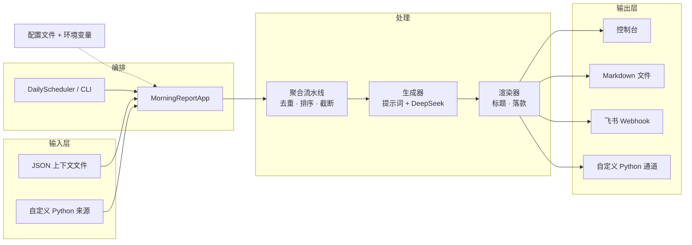
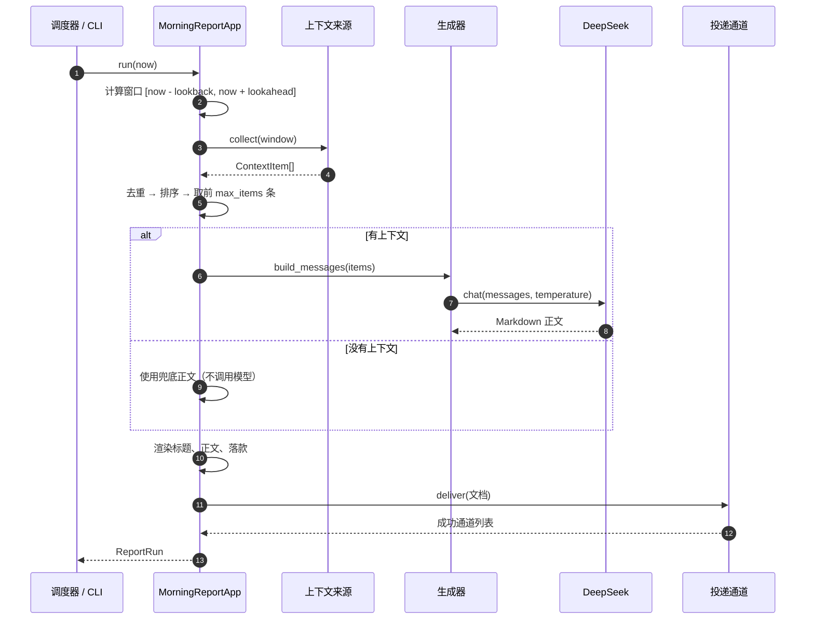

# 每日晨报架构设计

> 版本：v0.1（已实现）
> 代码：`morning_report/`
> 示例：`examples/config.example.json`、`examples/context.example.json`

## 1. 背景与目标

ZTE_memory 是服务于 PCE（Personal Context Engine，个人上下文引擎）的记忆系统。
每日晨报是它的第一个面向用户的产出：每天固定时间，把个人上下文压缩成一份
Markdown 简报，并投递到用户日常阅读的渠道（控制台、文件、飞书群等）。

设计目标：

- **来源可插拔**：日历、待办、飞书消息、GitHub 动态等都能作为上下文来源接入，
  新增来源不需要改动生成与投递逻辑。
- **模型单一**：只调用 DeepSeek，复用仓库已有的 `LLM.py` 非流式接口。
- **默认可靠**：单个来源失败不拖垮晨报；没有上下文时不空跑模型；投递失败可见。
- **两种运行方式**：常驻进程按天调度，或 `--once` 交给 cron / systemd timer。
- **隐私优先**：API Key、Webhook 密钥走环境变量；上下文只在本机与模型请求之间流动。

非目标（v0.1 不做）：多用户隔离、向量记忆检索、实时推送、事件总线、投递重试队列。
这些在[演进路线](#11-演进路线)里列出。

## 2. 总体架构



分层职责：

| 层 | 模块 | 职责 |
| --- | --- | --- |
| 配置层 | `config.py` | 读取 JSON、展开环境变量、校验时区/时间/参数；相对路径按配置文件目录解析 |
| 输入层 | `sources.py` | 定义 `ContextSource` 协议；内置 JSON 文件来源；动态加载 Python 来源 |
| 聚合层 | `pipeline.py` | 汇总所有来源，按标题+时间去重，按优先级和时间排序，截断到 `max_items` |
| 生成层 | `generator.py`、`render.py` | 构造中文提示词、调用 DeepSeek、清洗代码块、拼接固定标题与落款 |
| 投递层 | `delivery.py` | `Sink` 协议；控制台、文件、飞书 Webhook、自定义 Python 通道；部分失败容错 |
| 调度层 | `scheduler.py`、`app.py`、`cli.py` | 计算下一次执行时间，串起一次完整运行，提供命令行入口 |

## 3. 一次运行的时序



## 4. 数据模型

```python
@dataclass(frozen=True)
class ContextItem:
    title: str                      # 必填，一句话标题
    source: str = ""                # 来源名称，如“日历”
    detail: str = ""                # 补充说明
    happened_at: datetime | None    # 事件发生/计划时间，未知为空
    priority: int = 0               # 越大越靠前
    tags: tuple[str, ...] = ()
    url: str = ""

@dataclass(frozen=True)
class TimeWindow:
    start: datetime
    end: datetime

@dataclass(frozen=True)
class ReportRun:
    report_date: date
    window: TimeWindow
    items: tuple[ContextItem, ...]
    content: str
    delivered: tuple[str, ...]
    prompt: str = ""                # dry-run 时返回提示词
    generated: bool = True          # 是否真的调用了模型
```

- `ContextItem` 是所有来源与生成层之间的唯一契约；来源适配器只负责把各自
  的数据转换成它。
- `TimeWindow` 同时覆盖“回看”和“前瞻”：默认回看 24 小时、前瞻 12 小时，
  既包含昨天发生的事，也包含今天要做的事。
- `ReportRun` 让调用方（CLI、测试、未来的 API）不需要重新解析日志就能拿到
  本次结果。

## 5. 关键设计决策

### 5.1 为什么用配置驱动 + Python 类扩展，而不是内置一堆集成

v0.1 只内置 `json_file`，让用户可以在不改代码的情况下先跑通闭环。真正的外部
集成（日历、飞书、GitHub）依赖认证、分页、限流等细节，更适合作为独立模块按需
接入。`{"type": "python", "class": "包.模块:类"}` 让这类扩展不需要改动核心代码。

### 5.2 单个来源失败为什么是 fail-soft

晨报的价值在于“每天早上一定有东西看”。某个外部 API 临时不可用时，其余来源
仍然应该产出晨报；同时记录告警并在所有来源都失败时抛错，避免把“什么都没读到”
伪装成“今天没有事”。这是可用性与正确性之间的折中。

### 5.3 没有上下文为什么不调用模型

空上下文调用模型只会得到一段编造的套话，既浪费 token 又违背“不编造”的约束。
因此直接输出兜底正文，并照常投递，保持每日仪式感。

### 5.4 标题和落款为什么由代码生成

让模型只输出正文，可以减少标题格式漂移、日期错误和多余开场白。代码负责
`# 每日晨报 · 2026年11月4日 星期三` 与落款，模型负责内容组织。

### 5.5 投递为什么部分失败仍算成功

多通道投递时，文件归档成功、飞书临时失败，不应让整次运行失败；记录告警即可。
只有**所有**通道都失败才抛 `DeliveryError`。这保证文件归档、重试和人工补发都有据可查。

## 6. 配置

```json
{
  "timezone": "Asia/Shanghai",
  "schedule": {"at": "08:00"},
  "report": {
    "user_name": "示例用户",
    "lookback_hours": 24,
    "lookahead_hours": 12,
    "max_items": 30,
    "max_chars": 500,
    "temperature": 0.4,
    "model": "deepseek-chat"
  },
  "sources": [
    {"type": "json_file", "name": "手动上下文", "path": "context.example.json"}
  ],
  "delivery": [
    {"type": "console"},
    {"type": "file", "directory": "../reports"},
    {"type": "feishu_webhook", "url": "${FEISHU_BOT_WEBHOOK}", "secret": "${FEISHU_BOT_SECRET:-}"}
  ]
}
```

- 字符串支持 `${ENV_VAR}` 与 `${ENV_VAR:-默认值}`；引用了未设置且无默认值的
  变量会在加载配置时直接报错。
- 相对路径（`sources[].path`、`file.directory`）按**配置文件所在目录**解析，
  便于把配置和示例数据放在一起。
- 不写 `delivery` 时默认输出到控制台。

## 7. 扩展点

### 7.1 新增上下文来源

实现 `collect(window)` 并返回 `ContextItem` 列表即可：

```python
# my_sources/calendar.py
from morning_report.models import ContextItem


class CalendarSource:
    name = "calendar"

    def __init__(self, calendar_id: str):
        self.calendar_id = calendar_id

    def collect(self, window):
        for event in fetch_events(self.calendar_id, window.start, window.end):
            yield ContextItem(
                title=event.summary,
                source="日历",
                detail=event.description,
                happened_at=event.start,
                priority=3 if event.important else 1,
                tags=("会议",),
                url=event.html_link,
            )
```

配置：

```json
{"type": "python", "class": "my_sources.calendar:CalendarSource",
 "options": {"calendar_id": "primary"}}
```

注意：`type: python` 会执行本机代码，配置应视为可信输入。

### 7.2 新增投递通道

实现 `deliver(report, *, report_date)` 即可，可参考 `FileSink`。例如接入企业微信、
邮件或对象存储：

```python
class MySink:
    name = "my-sink"

    def deliver(self, report: str, *, report_date):
        ...
```

配置：`{"type": "python", "class": "my_sinks:MySink", "options": {...}}`。

### 7.3 调整提示词与模型

- 提示词在 `morning_report/generator.py` 的 `SYSTEM_PROMPT` 中集中维护。
- 模型默认 `deepseek-chat`，可通过 `report.model` 或环境变量 `DEEPSEEK_MODEL` 覆盖。
- 生成器通过 `chat_fn` 注入，测试时不需要真实 API。

### 7.4 运行方式

常驻进程：

```bash
python -m morning_report --config config.json
```

cron（推荐，进程无需常驻）：

```cron
0 8 * * * cd /path/to/ZTE_memory && DEEPSEEK_API_KEY=sk-... \
  python -m morning_report --once --config config.json >> logs/morning-report.log 2>&1
```

systemd timer 同理，ExecStart 使用 `--once`。`--dry-run` 只收集上下文并打印提示词，
适合无密钥环境排查数据问题。

## 8. 可靠性设计

| 场景 | 行为 |
| --- | --- |
| 单个来源报错 | 记录 warning，继续使用其他来源 |
| 所有来源报错 | 抛 `SourceError`，本次运行失败，避免静默空晨报 |
| 没有上下文 | 输出兜底正文，不调用模型，照常投递 |
| 模型调用失败/空响应 | 抛 `GenerationError`，本次运行失败 |
| 部分投递通道失败 | 记录 warning，其余通道继续；全部失败才抛 `DeliveryError` |
| 常驻调度中单次失败 | 记录异常，下一天继续 |
| 常驻进程错过计划时间 | 不自动补跑，等待下一个周期；需要补跑时使用 `--once` |
| 文件落盘 | 同一天重复运行会覆盖当天文件，天然幂等 |
| 飞书 Webhook | 不自动重试；网络重试可能造成重复消息，交由调用方决定 |

飞书自定义机器人以纯文本消息投递，Markdown 不会渲染成富文本；需要卡片样式时
可以在 `Sink` 层扩展 `interactive` 消息类型。

可观测性：日志只记录日期、条目数、通道名和文件路径，不打印晨报正文，避免隐私
内容进入日志。`ReportRun` 提供了结构化结果，便于未来接入指标与追踪。

## 9. 安全与隐私

- `DEEPSEEK_API_KEY`、`FEISHU_BOT_WEBHOOK`、`FEISHU_BOT_SECRET` 等密钥通过环境
  变量注入，不写入仓库；配置里的 `${VAR}` 在加载时展开。
- 上下文会随提示词发送给 DeepSeek。不要把密码、身份证号等敏感信息放进上下文
  文件；未来可在来源层增加脱敏。
- `json_file` 只读取本地文件；`python` 来源/通道会执行本机代码，配置需可信。
- 飞书签名使用 HMAC-SHA256，密钥不出现在请求体中。

## 10. 测试策略

`python -m unittest discover` 覆盖：

- 来源：窗口过滤、字段解析、非法 JSON/缺标题、相对路径解析；
- 流水线：去重、优先级/时间排序、截断、单源失败容错、全失败报错；
- 调度：`HH:MM` 解析、同日/跨日计算、时区换算；
- 生成：提示词包含上下文、代码块清洗、异常包装、空响应拒绝；
- 投递：文件写入、控制台输出、飞书签名与 payload、部分失败/全失败；
- 配置：默认值、环境变量展开、缺失变量、非法时区/时间、空来源；
- 应用：端到端生成投递、dry-run 不调用模型、空上下文兜底、窗口边界。

测试全部使用注入的假模型、假通道和临时目录，不需要网络与真实 API Key。

## 11. 演进路线

1. **更多来源**：飞书会话（复用 lark-cli 或机器人 API）、日历、GitHub 动态、浏览器书签。
2. **记忆检索**：接入 ZTE_memory 的长期记忆，按相关度召回历史上下文，而不是只靠时间窗口。
3. **质量评估**：建立晨报样本集，评估信息遗漏率、编造率与可读性，迭代提示词。
4. **投递可靠性**：失败重试、死信队列、发送回执与去重键。
5. **多用户与权限**：按用户隔离上下文、配置和投递目标。
6. **反馈闭环**：用户对条目标记“有用/无用”，用于排序与来源权重学习。
